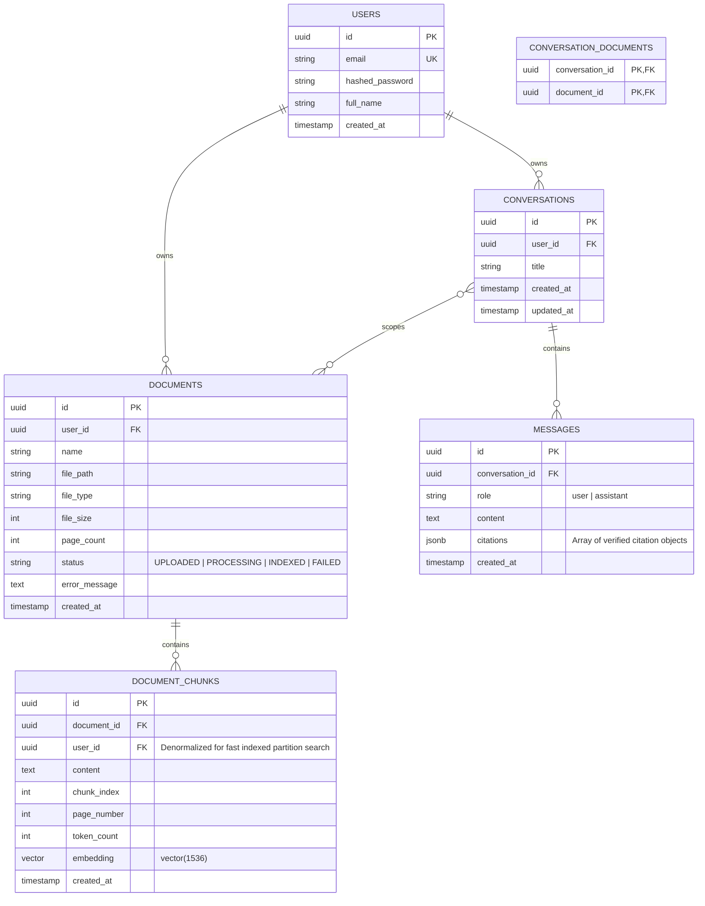

# 📘 DocuMind - Technical Specification & Production RAG Architecture Guide

> **Production-grade Architecture, Ingestion Pipelines, Multi-tenancy Security, and Engineering Roadmap for DocuMind Document Workspace.**

---

## 📑 TABLE OF CONTENTS
1. [Product Overview & Philosophy](#1-product-overview--philosophy)
2. [End-to-End System Architecture](#2-end-to-end-system-architecture)
3. [Production Database Schema (Multi-tenancy & Isolation)](#3-production-database-schema-multi-tenancy--isolation)
4. [Document Ingestion Pipeline (Parsing, Chunking, Fault Tolerance)](#4-document-ingestion-pipeline-parsing-chunking-fault-tolerance)
5. [Retrieval & Generation Engine (Query Rewriting, pgvector, Citation Verification)](#5-retrieval--generation-engine-query-rewriting-pgvector-citation-verification)
6. [Security, Error Handling & Production Readiness](#6-security-error-handling--production-readiness)
7. [Step-by-Step Backend Implementation Roadmap](#7-step-by-step-backend-implementation-roadmap)
8. [Interview Talking Points & Technical Defense](#8-interview-talking-points--technical-defense)

---

## 1. PRODUCT OVERVIEW & PHILOSOPHY

**DocuMind** is an enterprise-focused AI document workspace designed for seamless document analysis and reliable, evidence-backed question answering.

Unlike cluttered developer playgrounds or noisy AI agent platforms, **DocuMind** adheres strictly to a clean, minimal user journey:

$$\textbf{Documents} \longrightarrow \textbf{Ask} \longrightarrow \textbf{Answer} \longrightarrow \textbf{Sources}$$

### Core Architectural Directives:
- **Zero Framework Clutter**: Native Python + FastAPI + SQLAlchemy 2.0 + pgvector + official OpenAI SDK (No LangChain/LlamaIndex dependencies). Complete transparency over tokens, prompts, and vector calculations.
- **Strict Multi-tenancy**: Complete data isolation. User A can never query, inspect, or retrieve User B's documents or conversations, enforced directly at the database and retrieval levels.
- **Auditable Citations**: Citations are not just LLM hallucinatory tags; they are verified database records mapped to exact chunk IDs, file names, page numbers, and highlighted passages.
- **Conversational Intelligence**: Query re-writing and contextual memory support multi-turn conversational follow-up queries without breaking vector retrieval.

---

## 2. END-TO-END SYSTEM ARCHITECTURE

```
+----------------------------------------------------------------------------------------------------+
|                                      DOCUMIND ARCHITECTURE                                         |
+----------------------------------------------------------------------------------------------------+
|                                                                                                    |
|  [ FRONTEND - Next.js 16 (App Router + Tailwind CSS v4 + TypeScript) ]                             |
|    - Workspace Dashboard & Document Manager                                                        |
|    - Dynamic Routing: /chat/[conversationId] (Persistent history, multi-tab support)               |
|    - Split-screen Document & Passage Reader with Source Highlighting                               |
|    - Real-time Server-Sent Events (SSE) Streaming Receiver                                         |
|                                         |                                                          |
|                         REST / SSE (HTTP Bearer JWT)                                               |
|                                         v                                                          |
|  [ BACKEND - FastAPI Clean Architecture ]                                                          |
|    - Auth Middleware: Multi-tenant tenant_id extraction & validation                               |
|    - Ingestion Worker: Background tasks with state transitions (UPLOADED -> PROCESSING -> INDEXED) |
|    - Contextual Query Rewriter (Follow-up conversation resolver)                                    |
|    - Vector Retrieval Engine: Cosine distance calculation with Document Scope constraints          |
|    - Citation Validator: Guarantees references strictly match retrieved database chunks           |
|                                         |                                                          |
|                       SQLAlchemy 2.0 / psycopg3                                                    |
|                                         v                                                          |
|  [ DATA STORE - PostgreSQL 16 + pgvector extension ]                                               |
|    - Relational: users, documents, conversations, messages, conversation_documents                 |
|    - Vector Index: document_chunks.embedding vector(1536) indexed with HNSW (m=16, ef_construction=64) |
|                                                                                                    |
+----------------------------------------------------------------------------------------------------+
```

---

## 3. PRODUCTION DATABASE SCHEMA (MULTI-TENANCY & ISOLATION)

To prevent Insecure Direct Object Reference (IDOR) vulnerabilities and data leaks in shared environments, all core entities are bound to `user_id`.



---

## 4. DOCUMENT INGESTION PIPELINE (PARSING, CHUNKING, FAULT TOLERANCE)

### Lifecycle States:
$$\text{UPLOADED} \longrightarrow \text{PROCESSING} \longrightarrow \text{INDEXED} \quad (\text{or } \text{FAILED})$$

```
 [File Upload: PDF, DOCX, TXT, XLSX]
               │
               ▼
 [1. Validation & Storage]
   - Validate MIME type, size limit (max 25MB)
   - Compute SHA-256 hash to prevent duplicate files
   - Save file to secure disk path / S3 bucket
   - Insert document record with status='UPLOADED'
               │
               ▼
 [2. Document Parser Adapter]
   - PDF: PyMuPDF (fitz) / pypdf -> Extract text page-by-page (preserves page_number)
   - DOCX: python-docx -> Extract paragraphs & tables with structural heading labels
   - TXT/MD: UTF-8 stream reader
   - XLSX: pandas / openpyxl -> Convert tabular rows into structured semantic sentences
               │
               ▼
 [3. Semantic Text Chunking]
   - Token-aware sliding window (using tiktoken `cl100k_base`)
   - Target Size: 400 - 600 tokens (~1500 - 2200 chars)
   - Overlap: 50 - 80 tokens (guarantees semantic continuity across boundaries)
   - Strict Page Boundary Association: If a chunk spans two pages, attribute it to the dominant page
               │
               ▼
 [4. Batch Embedding Generation & Retry Mechanism]
   - Model: OpenAI `text-embedding-3-small` (1536 dimensions)
   - Batching: Process chunks in batches of 32 to avoid rate limits and reduce roundtrips
   - Exponential Backoff: Retry on HTTP 429/500 up to 3 times
               │
               ▼
 [5. Atomic DB Transaction]
   - Insert chunks with vector embeddings into `document_chunks`
   - Update document status='INDEXED'
   - On error: Rollback transaction, purge orphan chunks, set status='FAILED' with `error_message`
```

---

## 5. RETRIEVAL & GENERATION ENGINE

### 5.1 The Follow-Up Problem & Query Rewriting
When a user asks:
1. User: *"What was the consolidated revenue in Q3 2025?"* $\rightarrow$ Bot: *"1,450.8 billion VND."*
2. User: *"How much did it increase compared to last year?"*

Embedding *"How much did it increase compared to last year?"* directly will fail completely because it contains no domain keywords. 

**Solution: Query Condensation / Rewriting**
Before vector retrieval, the system feeds the last 2-3 chat messages along with the new query to an ultra-fast LLM prompt to rewrite it into a standalone query:
$$\text{Standalone Query: } \textit{"What was the revenue growth percentage in Q3 2025 compared to Q3 2024?"}$$

### 5.2 Cosine Distance vs Similarity in pgvector
In PostgreSQL `pgvector`, the operator `<=>` calculates **Cosine Distance**:
$$\text{Cosine Distance} = 1 - \text{Cosine Similarity}$$

When querying, we compute similarity explicitly:
```sql
SELECT 
    c.id AS chunk_id,
    c.document_id,
    d.name AS document_name,
    c.page_number,
    c.content,
    1 - (c.embedding <=> :query_embedding) AS similarity_score
FROM document_chunks c
JOIN documents d ON d.id = c.document_id
WHERE c.user_id = :current_user_id
  AND (:scope_empty OR c.document_id = ANY(:selected_doc_ids))
ORDER BY c.embedding <=> :query_embedding ASC
LIMIT :top_k;
```

> **Evaluation on Similarity Threshold**:
> Instead of hardcoding an arbitrary threshold (e.g. `0.7`), top-K candidates are filtered dynamically, and an empty response is triggered only when the top similarity score is below the dataset's calibrated baseline (e.g., `< 0.65` for `text-embedding-3-small`).

### 5.3 Backend-Enforced Citation Verification
To prevent the LLM from hallucinating citations:
1. Backend assigns explicit internal IDs (e.g., `SOURCE_1`, `SOURCE_2`) to retrieved database chunks.
2. The LLM is instructed in the system prompt: *"Reference sources using [SOURCE_1], [SOURCE_2] strictly where applicable."*
3. After the LLM outputs the answer, the Backend extracts all source markers:
   - Matches markers against the list of retrieved database chunks.
   - Any hallucinated tag that does not exist in the retrieved set is stripped out.
   - Valid tags are converted into rich citation metadata:
   ```json
   [
     {
       "index": 1,
       "document_id": "9b1deb4d-3b7d-4bad-9bdd-2b0d7b3dcb6d",
       "document_name": "Financial_Report_Q3_2025.pdf",
       "page": 3,
       "snippet": "Consolidated net revenue reached 1,450.8 billion VND in Q3 2025..."
     }
   ]
   ```

---

## 6. SECURITY, ERROR HANDLING & PRODUCTION READINESS

### 1. Ingestion Fault Tolerance & Transaction Isolation
- File uploads are validated for magic bytes (not just file extensions).
- Chunk generation and embedding insertion occur in an atomic SQLAlchemy transaction:
  ```python
  try:
      db.add_all(chunks)
      doc.status = "INDEXED"
      db.commit()
  except Exception as e:
      db.rollback()
      doc.status = "FAILED"
      doc.error_message = str(e)
      db.commit()
  ```
- Cascading Deletes: Deleting a document automatically wipes all associated vectors from `document_chunks` via foreign key `ON DELETE CASCADE`.

### 2. Multi-tenant Authorization Checks
Every endpoint validates ownership:
- Documents: `WHERE id = :doc_id AND user_id = :current_user.id`
- Conversations: `WHERE id = :conv_id AND user_id = :current_user.id`

### 3. Server-Sent Events (SSE) Resilience
- Proper streaming protocol with structured event types:
  - `event: token` -> sends incremental text token.
  - `event: citations` -> sends verified citation list.
  - `event: done` -> signals end of stream.
  - `event: error` -> communicates API or context errors cleanly.
- Client disconnect handling: aborts LLM generation when the browser tab is closed to save token costs.

---

## 7. STEP-BY-STEP BACKEND IMPLEMENTATION ROADMAP

```
┌────────────────────────────────────────────────────────────────────────┐
│ STAGE 1: Database Foundation & Multi-tenant Schema                     │
│  - Setup PostgreSQL with pgvector extension                            │
│  - Implement SQLAlchemy 2.0 models (User, Document, Chunk, Conv, Msg)  │
│  - Configure Alembic migrations and verify foreign key cascades        │
└──────────────────────────────────┬─────────────────────────────────────┘
                                   │
                                   ▼
┌────────────────────────────────────────────────────────────────────────┐
│ STAGE 2: Robust Document Ingestion Pipeline                            │
│  - Implement parsers: PDF (PyMuPDF), DOCX, TXT, XLSX                   │
│  - Implement tiktoken-based sliding window chunker with overlap        │
│  - Implement batch embedding generator with exponential retry          │
│  - Expose POST /api/v1/documents/upload with status transitions        │
└──────────────────────────────────┬─────────────────────────────────────┘
                                   │
                                   ▼
┌────────────────────────────────────────────────────────────────────────┐
│ STAGE 3: Contextual Retrieval & Citation Engine                        │
│  - Implement pgvector cosine similarity search with user/doc filters   │
│  - Build query condenser/rewriter for multi-turn conversations         │
│  - Develop strict Prompt Engineering template with source tagging      │
│  - Implement post-generation citation validation service               │
└──────────────────────────────────┬─────────────────────────────────────┘
                                   │
                                   ▼
┌────────────────────────────────────────────────────────────────────────┐
│ STAGE 4: Conversation APIs & SSE Streaming Integration                 │
│  - Implement conversation management: create, list, rename, delete     │
│  - Build SSE streaming endpoint: POST /api/v1/conversations/{id}/chat  │
│  - Connect Next.js frontend to real backend API endpoints              │
└──────────────────────────────────┬─────────────────────────────────────┘
                                   │
                                   ▼
┌────────────────────────────────────────────────────────────────────────┐
│ STAGE 5: Hardening, Evaluation & Production Prep                       │
│  - Add unit & integration tests (pytest + test database)               │
│  - Evaluate retrieval accuracy with custom Q&A test cases              │
│  - Containerize using Docker & Docker Compose                          │
│  - Add structured logging and request performance monitoring           │
└────────────────────────────────────────────────────────────────────────┘
```

---

## 8. INTERVIEW TALKING POINTS & TECHNICAL DEFENSE

When presenting DocuMind to tech leads and interviewers, leverage these engineering answers:

1. **Why avoid LangChain / LlamaIndex?**
   > *"I engineered the RAG pipeline natively using FastAPI, SQLAlchemy, and OpenAI's SDK. This keeps the application lightweight, eliminates dozens of fragile dependencies, makes token-streaming transparent, and avoids high-level abstractions that hide retrieval mechanics."*

2. **Why PostgreSQL + pgvector instead of standalone Vector DBs (Pinecone, Qdrant)?**
   > *"For our workload, pgvector eliminates distributed database complexity. We maintain strict ACID compliance, perform relational joins between user permissions, document scopes, and vector chunks in a single query, and avoid synchronizing data across two separate database vendors."*

3. **How do you handle multi-turn conversational follow-ups?**
   > *"A common RAG pitfall is embedding follow-up queries like 'How much did it increase?' which lack domain keywords. DocuMind implements a query condenser that analyzes recent chat history and rewrites the query into a standalone prompt before executing vector search."*

4. **How do you guarantee citations are not hallucinated?**
   > *"We treat citations as a two-phase contract: retrieved chunks are tagged with strict database IDs before entering the LLM context. Post-generation, the backend extracts and validates every citation tag against actual database chunk IDs before sending verified metadata to the frontend."*
